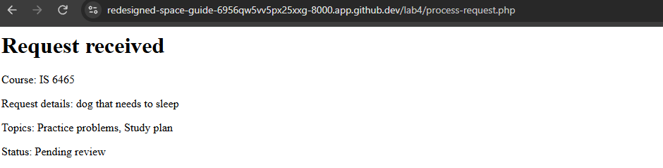

After submitting a valid form from the request-form.php page, we are redirected to process-request.php where a summary of our requet is displayed.

The header.php section provides a unified header for each .php page its applied to. This header includes the title of the web application: "Peer Tutoring Hub", and the title of the page the user is currently on.

fav.php provides navigation links in teh header, including navigation links to the requests.php and request-form.php pages.

footer.php provides a standardized footer for each .php page its applied to, which includes the text "Peer Tutoring Hub". 

The "require_once" condition is appropriate for .php files with the applied header, footer and nav info to prevent this content from being inadvertently applied more than once. 

The shared CSS data for each page is included in the styles.css file.

The purpose of the "reason" control is to recieve the input that the user entered into the form-field class and pass it to the process-request.php page for review. Within the process-request.php page, the entry is checked to ensure that the user entered text that is both greater than 10 characters and less than 500 characters. php should be recieving a string.

The purpose of the topics[] control is to allow the user to select more than one option from the list. The topics[] control signifies that multiple selections will be added to an array. php should be recieving an array.

The purpose of the preferredtime control is to signify that only one response is allowed. In request-form.php, preferredtime can only be one of the three available options, and this is enforced using radio buttons. php should be recieving a string of either Morning, Afternoon, or Evening. 

The purpose of the preferreddate control is to allow php to check predefined conditions before allowing the result. When the user enteres a date into the date field, this date is then passed to process-request.php where php checks that the date is not in the past. php should be recieving a date string.

The purpose of the form_name control is to point the controls within process-request.php towards the right data source. The server checks to verify that the data being received by process-request.php matches what was input in request-form.php. 

Valid Test:
Topics: Exam Review
Preferred Time: Morning
Course: IS6465
Preferred Date: 11/23/2026
Reason: 12345678910

Request was accepted
The message did display the application
All business rules were checked

Missing Value Test:
Topics: Exam Review
Preferred Time: Morning
Course: IS6465
Preferred Date: 11/23/2026
Reason: 

Request was rejected
"Please fill out this field"
The "What would you like help with?" text box was checked for the total number of entered characters.

Past Date Test:
Topics: Exam Review
Preferred Time: Morning
Course: IS6465
Preferred Date: 09/23/2026
Reason: 12345678910

Request was rejected
"Preferred Date Cannot be in the Past"
The "Preferred Date" section checked to see if the entered date was in the past. 

CRUD Action:        Page:
Create              request-form.php
Read one request    request-details.php
Read all requests   requests.php
Update              request-details.php
Delete              request-details.php

request_id= appears in the request details url
A GET query parameter appropriate for viewing one request because it identifies which request to pull without altering any of the page data.
An actual update or delete later use POST rather than GET because POST is designed to send information that changes data on the server, whereas GET is intended to only retrieve information. 