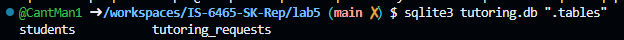
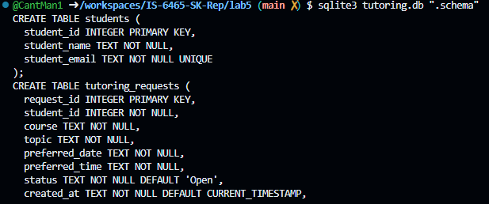
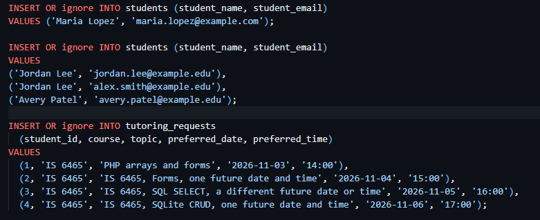
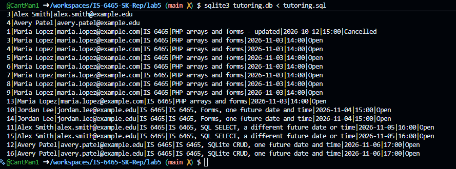
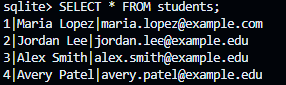
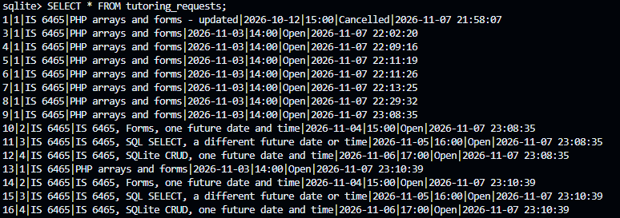
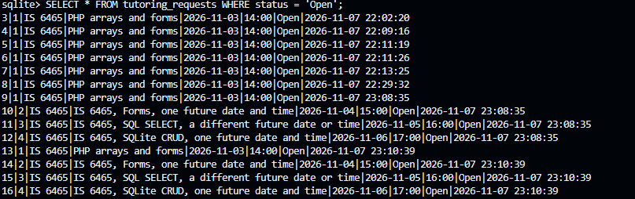
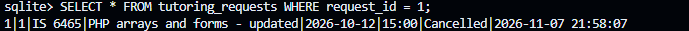
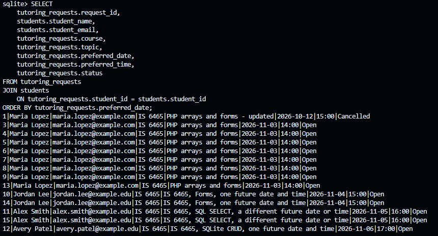

Screenshot of .tables command:

Screenshot of .schema command:

Which column is the primary key in each table?
Students: student_id
Tutoring_Requests: request_id

Which column is the foreign key and what relationship does it represent?
student_id is the foreign key, and it represents a many-to-one relationship.

student_email is marked "unique" so that the table enforces one email address per one user. 

Insert statements:

Select * output:

Jordan has one student row but two request rows because he submitted two requests. The 'student' table correctly identified him as the same person, but the 'requests' table recorded both of his requests. 

part3:
1. 
2. 
3. 
4. 
5. 

The JOIN condition connects the matching data between the students and requests tables based on student id. 
The difference between Join and Where is that Where is used to filter records from one data source based on a single condition, whereas Join is used to filter data from multiple tables based on a single condition.
The application should retrieve one request by request id instead of topic because students could enter multiple requests under the same topic. 

part4
UPDATE tutoring_requests
SET topic = 'New Topic'
WHERE request_id = 10
AND student_id = 2;

UPDATE tutoring_requests
SET status = 'Cancelled'
WHERE student_id = 4;

SELECT * FROM tutoring_requests;
1|1|IS 6465|PHP arrays and forms - updated|2026-10-12|15:00|Cancelled|2026-11-07 21:58:07
3|1|IS 6465|PHP arrays and forms|2026-11-03|14:00|Open|2026-11-07 22:02:20
4|1|IS 6465|PHP arrays and forms|2026-11-03|14:00|Open|2026-11-07 22:09:16
5|1|IS 6465|PHP arrays and forms|2026-11-03|14:00|Open|2026-11-07 22:11:19
6|1|IS 6465|PHP arrays and forms|2026-11-03|14:00|Open|2026-11-07 22:11:26
7|1|IS 6465|PHP arrays and forms|2026-11-03|14:00|Open|2026-11-07 22:13:25
8|1|IS 6465|PHP arrays and forms|2026-11-03|14:00|Open|2026-11-07 22:29:32
9|1|IS 6465|PHP arrays and forms|2026-11-03|14:00|Open|2026-11-07 23:08:35
10|2|IS 6465|New Topic|2026-11-04|15:00|Open|2026-11-07 23:08:35
11|3|IS 6465|IS 6465, SQL SELECT, a different future date or time|2026-11-05|16:00|Open|2026-11-07 23:08:35
12|4|IS 6465|IS 6465, SQLite CRUD, one future date and time|2026-11-06|17:00|Cancelled|2026-11-07 23:08:35
13|1|IS 6465|PHP arrays and forms|2026-11-03|14:00|Open|2026-11-07 23:10:39
14|2|IS 6465|IS 6465, Forms, one future date and time|2026-11-04|15:00|Open|2026-11-07 23:10:39
15|3|IS 6465|IS 6465, SQL SELECT, a different future date or time|2026-11-05|16:00|Open|2026-11-07 23:10:39
16|4|IS 6465|IS 6465, SQLite CRUD, one future date and time|2026-11-06|17:00|Cancelled|2026-11-07 23:10:39

A Where clause is essential in an update statement because it is the defining factor of where the update should be applied.

The Peer Tutoring Hub uses a 'Cancelled' status instead of deleting the entry so that historical data is retained in the even the student wants to reestablish their request.

