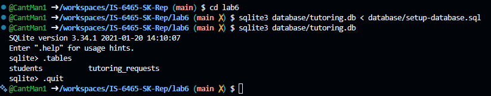
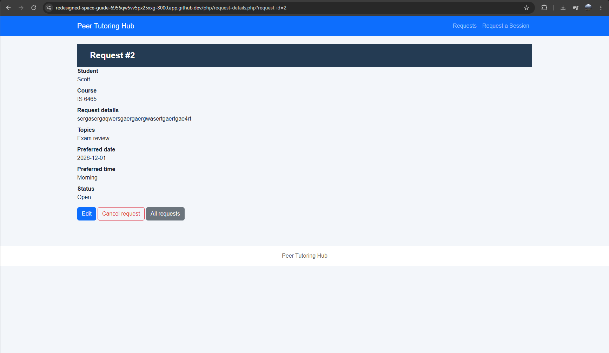

Part1:

Part2:
URL opened in browser: https://redesigned-space-guide-6956qw5vv5px25xxg-8000.app.github.dev/php/request-form.php
Confirmed that request was saved and displayed.

Part3:
Test        	                             What I Did      	             Expected Result	                                        Actual Result           P/F
Submit a valid request                       Submitted valid req             A new tutoring request is created with status Open.        Same as expected        P
View all requests                            Viewed all reqs                 The new request appears in the request list.               Same as expected        P
Filter requests                              Clicked filter button           Filtering by course or status shows matching requests.     Same as expected        P
Edit an Open request                         Edited open req                 The revised values are displayed.                          Same as expected        P
Cancel an Open request                       Cancelled open req              The request status changes to Cancelled.                   Same as expected        P
Try to edit or cancel a cancelled request    Attempted to edit open req      The application does not allow the change.                 Same as expected        P

Part4:
Which file displays the tutoring request form?
Request-Form.php

Which file receives the submitted form data?
process-request.php

Which file opens the PDO connection to SQLite?
db.php

Which file coordinates validation and the database transaction?
requestService.php

Which files contain the SQL statements?
studentPDO.php & requestPDO.php

Which table stores student information?
students

Which table stores tutoring requests?
tutoring_requests

How does a tutoring request connect to the student who submitted it?
student_id as the primary key in tutoring_requests references the student_id as the foreign key in students. 

Part5:
$ php tests/integration-tests.php
Xdebug: [Step Debug] Could not connect to debugging client. Tried: localhost:9000 (through xdebug.client_host/xdebug.client_port) :-(
PASS UC01 create and Open
PASS Lab 4 checkbox values preserved
FAIL Duplicate email reuses student
FAIL UC02 course and status filter
PASS Invalid reason rejected
FAIL Invalid submission writes nothing
PASS Edit Open request
PASS Updated reason persisted
PASS Cancel Open request
PASS Cancelled row retained
PASS Second cancellation rejected
PASS Unrelated request unchanged
PASS FK enforced
PASS UC02 empty filter result
FAILURES: 3

Dont know why this integration test is returning errors. I did not make any edits to the integrations-tests.php file or any of the other files related to this verification.

Part6:
Requirement  -   Application Page   -    Service or Validation   -    Repository or SQL   -    Database Table   -   Test Evidence

Student submits a tutoring request	-	Request-Form.php  -  Req shows up in the list of requests  -  Request data is added to relevant tables  -  Student info is added to the student table and the requests details are addede to the tutoring_requests table.  -  Submit a new request and verify if the new request details appear in the "requests" page. 

Suggested AI Test:
Test case: Request creation rolls back atomically on database failure

Setup: Use a valid submission for a student whose email is not yet in the database. Make SQLite reject the request insert.
Action: Call submitRequest.
Expected result: The call fails, and neither the student nor the tutoring request remains in the database.
This verifies the transaction rollback behavior in requestService.php, complementing the existing creation checks in integration-tests.php.

Whether it is already covered by tests/integration-tests.php.
This test does not appear to be covered within integration-tests.php

How you would test it manually or add it to the integration test file.
I would test it manually by submitting a valid request on behalf of a student who is not in the "students" table. If the request is rejected and no data is stored, then the test was successful.

Whether the AI generated test is appropriate for this application.
I dont this this test is exactly appropriate given the context of this application. I'm assuming the intention is to prevent the program from just creatign a brand new entry into the students table for every new student that submits a request, but maybe it would make more sense for the program to redirect the user to a "user requests" page or something before allowing them to submit a tutoring request. Also, if this page is behind a login wall (which is should be if its only accessible to students), then the list of students in the students table should already correspond with the list of expected users from the university. 

The AI tool helped me understand, trace, and test the application by quickly explaining the relationships between each of the files present in this lab. Given that I didnt write this code, its very helpful to get a quick summary of how the files are linked/connected without having to dig through the code of each one. However, even though the AI was correct with each of its assessments, its still important to verify that each statement is correct before committing to any changes based on that information. Failing to verify AI-backed assessments could result in verifications being incorrectly validated or logical errors being missed in more complex programs. 

Part7:
The JOIN statement queries the results from the tutoring_requests table based on the matching student_id value from the students table. 