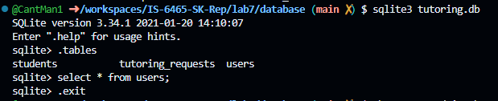
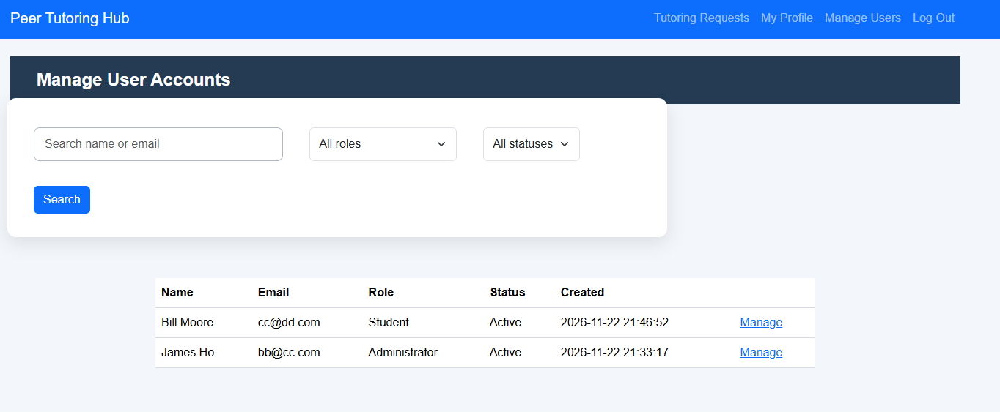

part1- 
Generate code for all user management use cases UM-01 through UM-10 in the User Management Design Document. Use the Application Builder, Test Harness Generator, and Traceability Auditor documents as implementation guidance. Follow the authentication, authorization, session management, password hashing, CSRF protection, and role based access practices in the Authentication Reading Handout. Use lab6.zip as the existing Peer Tutoring Hub application to extend. Preserve the Lab 6 three tier architecture and update the application as needed to support user registration, login, logout, profile management, administrator access, and protected tutoring request workflows. Return a complete Lab 7 application package with all updated and new files. 

image-1.png

lab7 extends lab6 by adding user accounts, login authentication and separate accounts with different privileges. 

UM-01 -> create user account. Verified through register.php

part2-
sqlite3 tutoring.db < setup-database.sql
sqlite3 tutoring.db < upgrade-to-user-management.sql

sqlite3 tutoring.db
.tables
confirmed all 3 tables appeared

part3-

part4-
https://redesigned-space-guide-6956qw5vv5px25xxg-8000.app.github.dev/php/login.php
opened sucessfully
directed to login page.

part5-
image.png

Test - What I did - Expected Result - Actual Result - Pass or Fail
Register a Student Account - Register a new student type account - Student account is created - Student account is created - P
Log in as student - log in with student credentials - Student can access protected student pages - Student can access protected student pages - P
View or update profile - view profile - Profile information is displayed or saved - Profile information is displayed or saved - P
Create tutoring request - requested tutoring session - A new request is created with status open - A new request is created with status open - P
Edit open request - edited open request - Updated request information is displayed - Updated request information is displayed - P
View my requests - clicked tutoring requests - Student sees the student’s own requests - Student sees the student’s own requests - P
Log out - logged out - Session ends and login page appears - Session ends and login page appears - P

part6-
Authentication is when the user enters their credentials at the login page.
Authorization is when a user is attempting to access privileged information, the system checks to see if the request is coming from an admin account. 
Students are only able to view and edit requests that they create.
Manage users is limited to admins, and the ability to see all requests is also limited to admins.
The user will either be blocked or asked to login again.

part7-
register.php
register.php
auth.php
userService.php
userService.php
userPDO.php through createUser() and linkStudentToUser()
users & students

login.php
login.php
userPDO.php
login.php
Regenerates the session ID, clears existing session data, stores user_id, display_name, role, and last_activity. Generates a new CSRF token, redirects the user to profile.php.
prevents session fixation attacks
it reads the user's role from the users table and stores it in the session data.
Password hashing and verification belong in the application layer because it localizes security processing and ensures that password handling is loaded consistently whenever users log in. The presentation page should only be used for displaying website visuals and collecting form data, and the database setup script should only be used for creating initial database structures. 

part8-
validation-tests.php -pass
user-management-tests.php -pass
integration-tests.php -pass

part9-
Accurate AI Statement: register.php Renders the full-name, email, password, confirm-password, and account-type fields.
Verification in the code: 
<label class="form-label">Full name</label><input class="form-control mb-3" name="full_name" maxlength="120" required value="<?=escapeHtml($_POST['full_name']??'')?>">
<label class="form-label">Email</label><input class="form-control mb-3" type="email" name="email" maxlength="254" required value="<?=escapeHtml($_POST['email']??'')?>">
<label class="form-label">Password (at least 10 characters)</label><input class="form-control mb-3" type="password" name="password" minlength="10" required>
<label class="form-label">Confirm password</label><input class="form-control mb-3" type="password" name="confirm_password" minlength="10" required>
<label class="form-label">Account type</label><select class="form-select mb-3" name="role" required>
<option value="Student" <?=($_POST['role']??'Student')==='Student'?'selected':''?>>Student</option>
<option value="Administrator" <?=($_POST['role']??'')==='Administrator'?'selected':''?>>Admin</option

Requirement - Presentation Page - Authentication or Authorization - Service or Validation - Repository or SQL - Database Table - Test Evidence
Student registers an account - register.php - auth.php - userService.php - userPDO - users & students - can log into newly created account.
Student logs in - register.php - register.php > verifyCsrfToken() - userPDO - userPDO - users - user can successfully log in and view student level pages only.
Student creates a tutoring request - request-form.php - request-form.php > requireLogin() - process-request.php - studentPDO.php - tutoring_requests - student user is able to create a new tutoring request.
User logs out - logout.php - startSecureSession() > verifyCsrfToken() > logoutSession() - verifyCsrfToken() > logoutSession() - N/A - N/A - User is redirected to the logout page and can no longer access site pages without logging back in. 

Suggested Test: A logged in student tries to access admin-users.php manually, they should be denied access.
It does not seem like this specific scenario is covered under the provided test files.
I would test it manually by logging in as a student and editing the URL to redirect me to the admin-only page.
I think this test is appropriate for this application. There are existing tests similar to it that were provided in the test files, but not this test specifically. 

AI tools helped me understand this application by quickly and accurately summarizing the updates between lab 6 and 7. Additioanlly, the AI updates between labs 6 and 7 were not made consistently with the results the professor got in the lecture, so there was a fair amount of debugging required for me to understand why my results differed. The AI really helped me trace these issues and quickly explained why I was recieving the results I was, and helped update the application so that I could continue with this lab. 

part10-
