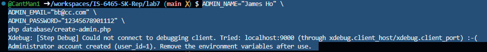

part1- 
Generate code for all user management use cases UM-01 through UM-10 in the User Management Design Document. Use the Application Builder, Test Harness Generator, and Traceability Auditor documents as implementation guidance. Follow the authentication, authorization, session management, password hashing, CSRF protection, and role based access practices in the Authentication Reading Handout. Use lab6.zip as the existing Peer Tutoring Hub application to extend. Preserve the Lab 6 three tier architecture and update the application as needed to support user registration, login, logout, profile management, administrator access, and protected tutoring request workflows. Return a complete Lab 7 application package with all updated and new files. 

image-1.png

lab7 extends lab6 by adding user accounts, login authentication and separate accounts with different privileges. 

UM-01 -> create user account. Verified through register.php

part2-
sqlite3 tutoring.db < setup-database.sql
sqlite3 tutoring.db < upgrade-to-user-management.sql

sqlite3 tutoring.db
.tables
confirmed all 3 tables appeared

part3-

part4-
https://redesigned-space-guide-6956qw5vv5px25xxg-8000.app.github.dev/php/login.php
opened sucessfully
directed to login page.

part5-
image.png

